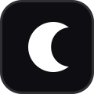
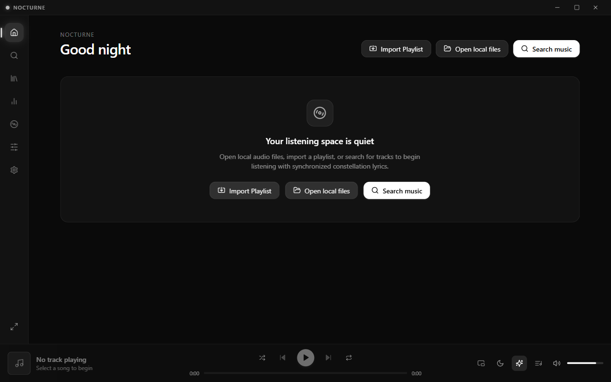
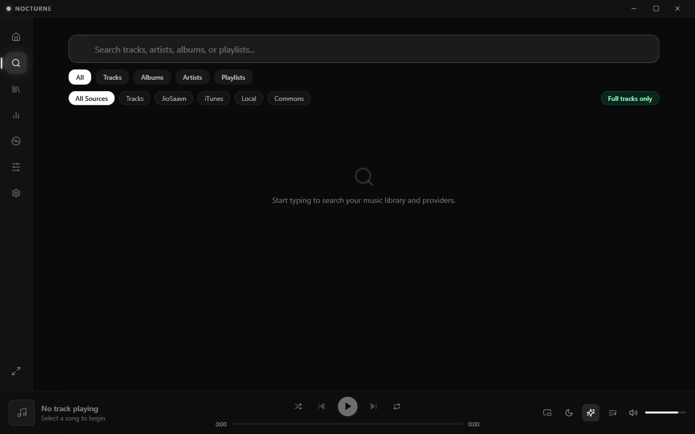
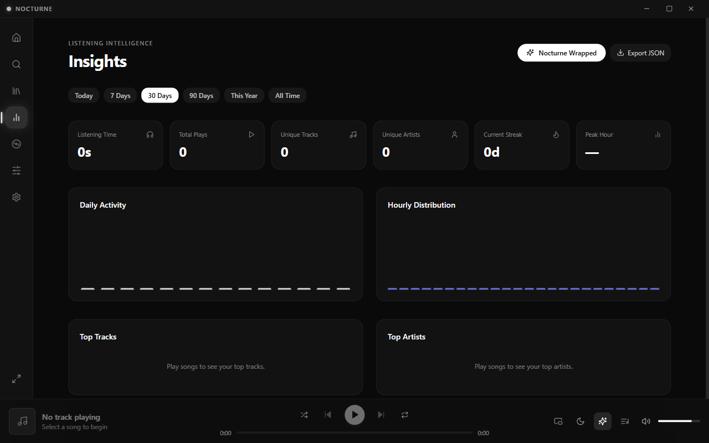
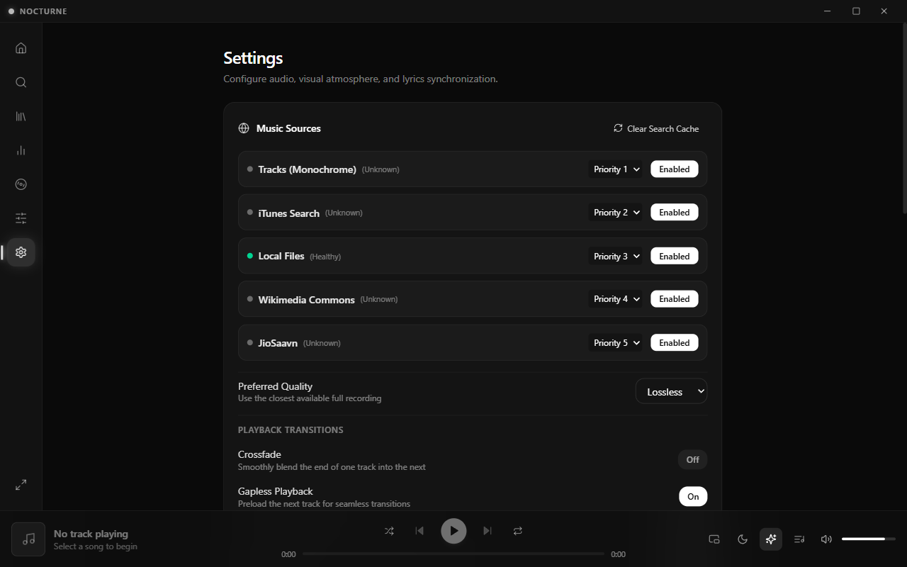

<div align="center">



# Nocturne

**A minimalist, privacy-first Windows desktop music player with real-time audio visualizations and synchronized lyrics.**

[](https://github.com/Akhil-cit/Nocturne/releases/tag/v0.1.1)

[](https://github.com/Akhil-cit/Nocturne/releases/tag/v0.1.1)
[](LICENSE)
[](https://github.com/Akhil-cit/Nocturne/releases)
[](https://www.electronjs.org/)
[](https://react.dev/)

</div>

---

## Screenshots

| Home | Universal Search |
|---|---|
|  |  |

| Listening Insights | Settings & Backup |
|---|---|
|  |  |

---

## Features

### Discovery & Library Management
- **Universal Search**: Search across **All**, **Tracks**, **Albums**, **Artists**, and **Playlists** with dedicated detail pages.
- **Public & Local Sources**: Browse metadata from Tracks, JioSaavn, Apple iTunes Search, Wikimedia Commons, and local audio files.
- **Playlist & Selection Controls**: Right-click and three-dot context menus, multi-select (`Ctrl+Click`, `Shift+Click`, `Ctrl+A`), playlist clipboard (`Ctrl+C`, `Ctrl+X`, `Ctrl+V`), smart mix (`On Repeat`), and playlist folders.
- **Backup & Restore**: Export and restore your library and settings locally using `.nocturne-backup` files.

### Synchronized Lyrics & Translation
- **Display Modes**: Standard synchronized lyrics panel, **Spotify-style live lyrics** with album-derived dynamic backgrounds, and **Constellation** word-by-word view.
- **Lyrics Translation**: On-demand **Original**, **Original + English**, and **English Only** translation using MyMemory's public API with local caching and `.lrc` timing offset (`-0.1s` / `+0.1s`).

### Visualizations, Player & Desktop
- **Visualization Modes**: Constellation, Cinematic, Floating, Karaoke, Minimal, Orbit, Particle, Wave, and Spotify.
- **Audio & Playback Controls**: Web Audio equalizer, configurable transition preferences (Crossfade / Gapless), Sleep Timer, Floating Mini Player (PiP) with synced scrolling lyrics, and Windows Taskbar Thumbnail Toolbar controls.
- **Listening Insights & Wrapped**: Local-only analytics tracking elapsed playback time, peak hours, top tracks/artists, and Nocturne Wrapped summary cards.

---

## Windows Installation

1. Download **`Nocturne Setup 0.1.1.exe`** from [GitHub Releases](https://github.com/Akhil-cit/Nocturne/releases/tag/v0.1.1).
2. Run the installer (per-user NSIS installation; admin rights are not required unless installing system-wide).
3. If Windows SmartScreen warns about an unsigned executable, click **More info** -> **Run anyway**.

Verify integrity against `SHA256SUMS.txt` attached to the release.

---

## Development Setup

### Prerequisites
- Node.js >= 20
- npm >= 10
- Windows 10 / Windows 11 (x64)

```bash
git clone https://github.com/Akhil-cit/Nocturne.git
cd Nocturne
npm install
npm run electron:dev
```

### Production Build

```bash
npx tsc --noEmit
npx vite build
npx electron-builder --win --config.directories.output=release-current
```

---

## Architecture & Privacy

- **Local-First Storage**: Playlists, liked songs, listening history, analytics, and backups are stored locally on your machine. No Nocturne accounts or telemetry servers are used.
- **External APIs**: Only public metadata, artwork, lyrics (`lrclib.net`), and optional translation (`api.mymemory.translated.net`) endpoints are queried during user-initiated playback or search.
- See [docs/ARCHITECTURE.md](docs/ARCHITECTURE.md) and [docs/SECURITY_AUDIT.md](docs/SECURITY_AUDIT.md) for technical details.

---

## Tech Stack

| Layer | Technology |
|---|---|
| Desktop Shell | Electron 36 |
| UI | React 19, React Router 7, Tailwind CSS v4, Lucide Icons |
| Language & Bundler | TypeScript 5, Vite 6 |
| State Management | Zustand |
| Audio | HTML5 Audio + Web Audio API |
| Testing | Playwright (Electron) |

---

## Known Limitations

- **Windows Quick Settings (`Win + A` / SMTC)**: Competing media players (such as Spotify) may supersede Nocturne in Windows SMTC.
- **Session Resume Timestamp**: On some streaming sources, resuming after restart may begin at `0:00` if the stream is not immediately seekable on `canplay`.
- **Wired Headphone Inline Controls**: Not verified via automated testing.
- **Unsigned Installer**: Releases are currently unsigned; Windows SmartScreen may prompt on first run.
- **Live Auto-Update & NSIS Upgrade**: Fresh NSIS install/uninstall and live version-to-version auto-update between GitHub Releases have not been verified end-to-end.

See [docs/KNOWN_ISSUES.md](docs/KNOWN_ISSUES.md) for details.

---

## License & Third-Party Acknowledgements

Licensed under the **Apache License, Version 2.0** — see [LICENSE](LICENSE).

- Architectural inspiration from [Monochrome](https://github.com/monochrome-music/monochrome) (Apache-2.0) — see [NOTICE](NOTICE) and [THIRD_PARTY_NOTICES.md](THIRD_PARTY_NOTICES.md).
- Contributing & security disclosure policies: [CONTRIBUTING.md](CONTRIBUTING.md) and [SECURITY.md](SECURITY.md).
