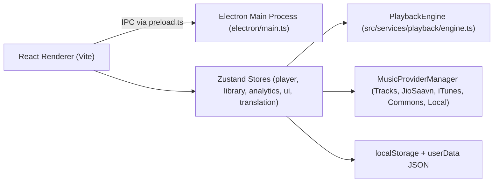

# Nocturne Architecture

Nocturne is an Electron + React + TypeScript desktop music player.

## Key Subsystems
- **Electron Main (`electron/main.ts`)**: `BrowserWindow` (`contextIsolation: true`, `nodeIntegration: false`), Windows Taskbar `setThumbarButtons`, `Tray`, PiP `MiniPlayerWindow`, and URL-validated `shell:openExternal`.
- **Playback (`src/services/playback/engine.ts`, `sessionPersistence.ts`)**: HTML5 `<audio>` + Web Audio EQ + Media Session API + debounced session checkpointing.
- **Providers (`src/services/music/`)**: `TracksProvider`, `JioSaavnProvider`, `ItunesProvider`, `CommonsProvider`, `LocalFileProvider`, plus cached `artworkResolver.ts` and `recommendationService.ts`.
- **Lyrics & Visuals (`NowPlaying.tsx`, `SpotifyLyrics.tsx`, `LyricsStage.tsx`)**: Synced `.lrc` / `lrclib` lyrics, MyMemory translation (`Original`, `Original + EN`, `English Only`), Constellation/Spotify/Immersive modes.
- **Analytics & Backup (`analyticsStore.ts`, `listeningAnalytics.ts`, `backupService.ts`)**: Monotonic `performance.now()` listening duration tracking, Insights & Wrapped, and portable `.nocturne-backup` export/restore.
